Welcome to **Computing in the shadow of AI**, where I try re-purposing, upgrading, optimizing and fixing older hardware because I am too broke to afford the current hardware prices.

## The Plan
Today I want to install **[Immich](https://immich.app)**. Immich is a self-hosted photo backup and organisation software and I will use it to finally organise all of my vacation photos.

Since Immich requires multiple components (a Server, a Postgres database, a Redis database and a Machine learning container) all running in Docker, the plan is as follows:

- Create a Debian VM
- Install Docker
- Install Immich and all required services on Docker
- Enjoy

This time I chose a **Virtual Machine** over a **LXC container**, because while it is possible to set up **Docker** in a container, it is much easier to do in a **VM**.

## Creating Debian VM
I choose **[Debian](https://www.debian.org/)** as the operating system for the **VM** because I value stability over the newest software and **Debian** is a trusted and reliable choice for servers. Their own website describes it best: **"Debian is stable and secure."** and **"Debian provides smooth Upgrades."** 

Before I can start setting up my **VM**, I need to download my **image file** from their server. Here is the link I used: **[Debian 13.7.0 ISO](https://cdimage.debian.org/debian-cd/current/amd64/iso-cd/debian-13.7.0-amd64-netinst.iso)**

You can download it to your Proxmox node by navigating to one of your storages (In my case **local**) and selecting the **ISO Images** tab. Then simply paste your download link and hit **Download**

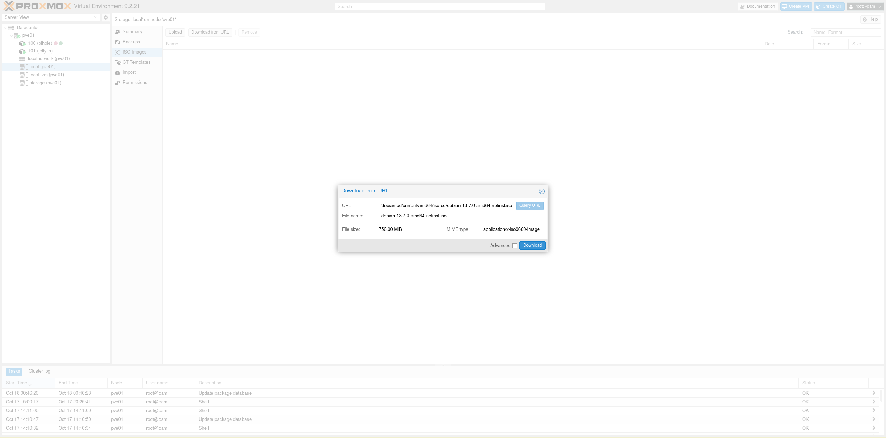

Now we can start configuring our **VM**. Similarly to a container, navigate to your Proxmox Node where you want to install the **VM**, **Right-Click** it and select **Create VM**. Then follow the instructions:

Choose a **hostname** and a **VM ID**. I chose docker-host as my hostname.

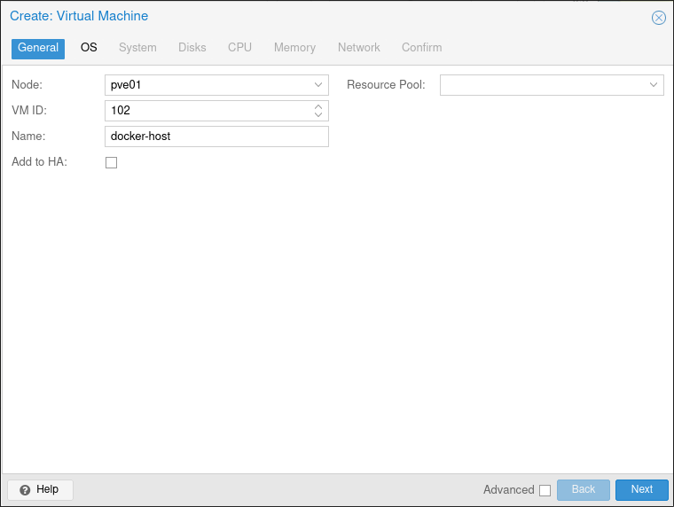

Then choose the **Image file** downloaded in the previous step.

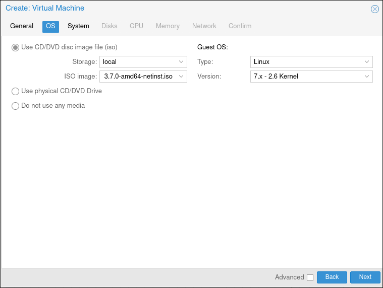

I left the default system settings, since I do not need anything special (like a GPU passthrough) for this VM.

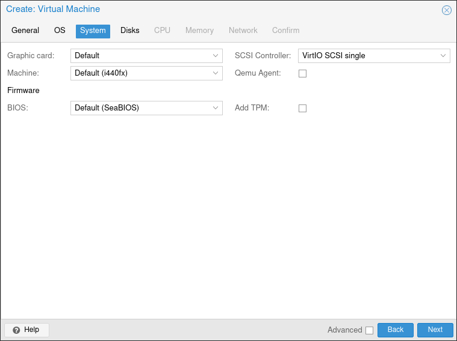

Give the VM some **storage**. This is only for the installation, the photos will be stored in a seperate storage location that we will add later.

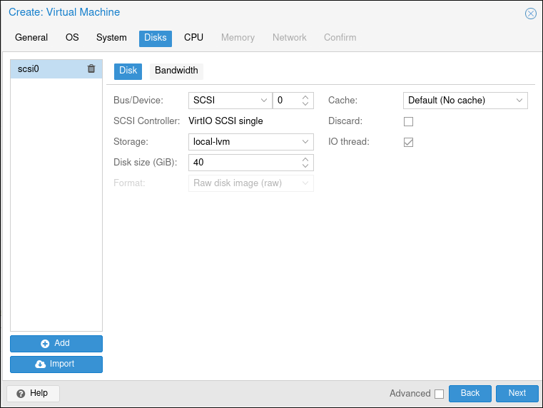

Assign some **CPU cores**. I gave it **3** so that the machine learning does not slow the whole app down to a crawl, if I decide to use it.

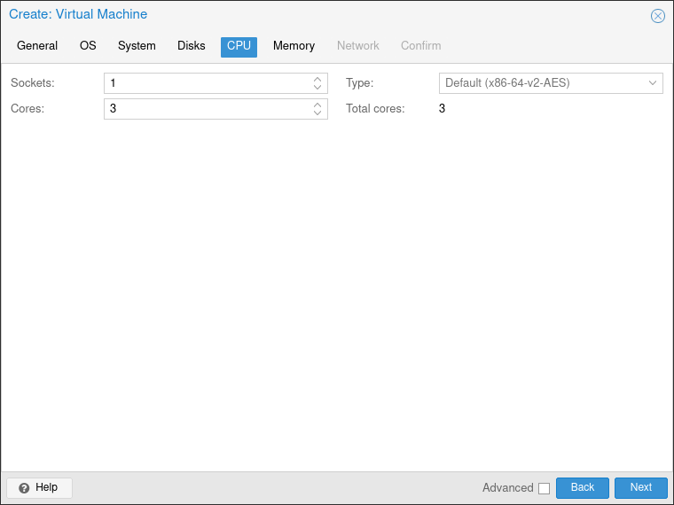

Assign some **Memory**. I gave it **6GB** since that is the minimum requirement in the Immich docs.

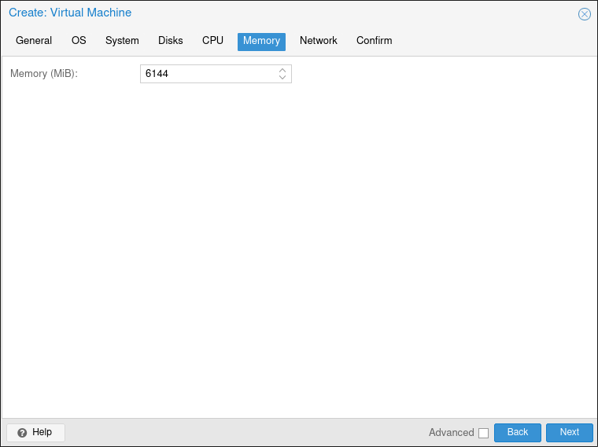

Give the VM a virtual network interface. I just left the default options here.

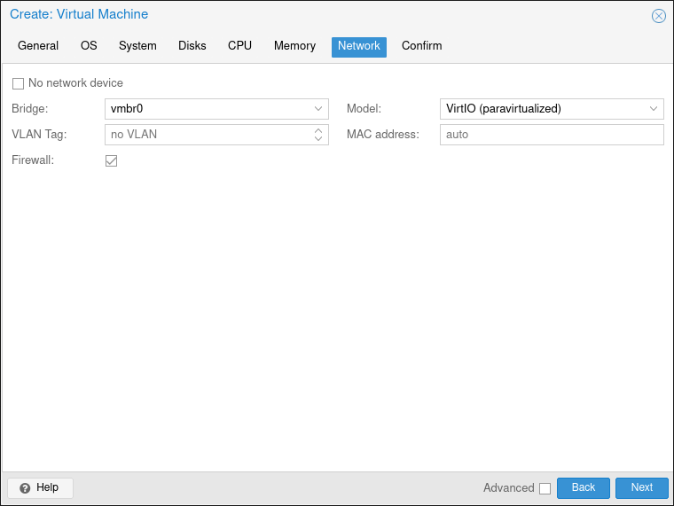

Review your choices and hit **FINISH**

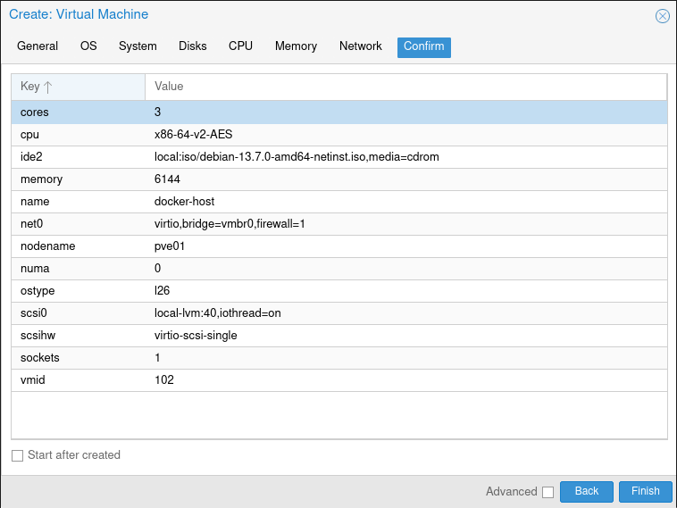

Before I start up the **VM** for the first time, I still have to assign it the storage space for the photos. For this navigate to the newly created VM and then go to **Hardware**. There simply click **Add > Hard Disk**, select the **storage** and **disk size** and hit **Add**. Now the VM has another **"Hard Drive"** where I can save the actual photos and videos to.

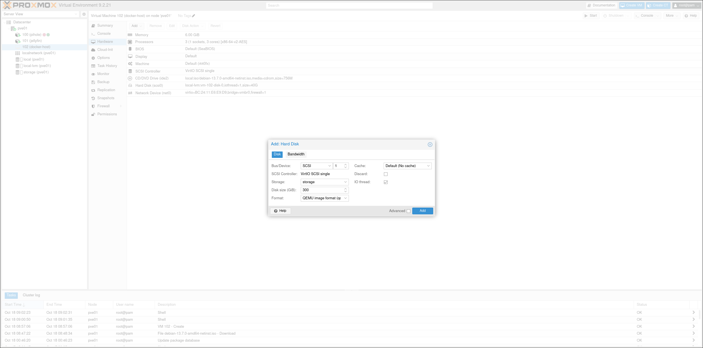

Now we are ready to install all of the necessary software onto the VM.

## Installing Software
When launching the **VM** for the first time you will be greeted by the installer of your chosen **OS**, in my case **Debian**. Simply install the **OS** like you would on any desktop machine.

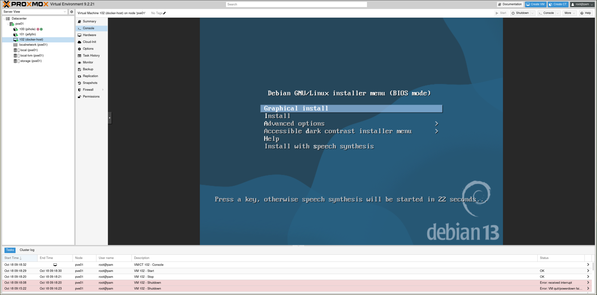

I had a lot of problems with using the **Proxmox NoVNC** console, since I am not using a default US keyboard, so the following commands are done by **SSH**'ing into the VM. During the install, simply check the **SSH Server** box during the software selection screen.

To SSH into a machine, open a terminal and use the following syntax:
```bash
ssh <YOUR USER>@<YOUR VM IP>
```

### Networking setup 
In the OS setup you can usually chose to set the network settings. I recommend setting it to **dhcp** and reserving a static IP in your routers **DHCP** **server**. The **MAC address** for that can be found in **VM > Hardware > Network Device**.

If you cannot chose to set your network interface to **dhcp** during the installation, here is how you do it manually in **Debian**:

Log into your **VM** and find the name of your virtual network interface. It will It will typically be named something like **`ens18`**, **`eth0`**, or **`enp0s3`**. Use this command to list all network interfaces:
```bash
ip addr show
```

Then open the network interfaces file with nano (or your favourite text editor):
```bash
sudo nano /etc/network/interfaces
```

Find the **iface** with the name of your interface make sure it is set to **dhcp**. My configuration for example looks like this:
```bash
allow-hotplug ens18 
iface ens18 inet dhcp
```

Exit your **SSH** connection and login to the VM with the IP address reserved by the router.

### Storage setup
To make sure Immich can use the storage space we have allocated earlier from **Proxmox**, we need to do a couple of simple steps. First create a directory to mount the storage **"Hard Disk"** to.
```bash
mkdir -p /mnt/immich-storage
```

Next we have to identify the target disk. Run the following command and find the name of the disk that matches the storage size we have allocated earlier.
```bash
lsblk
```

Now we have to create a partition table and partition on the disk. We will do this via `fdisk`, but `parted` is another popular software for this.
```bash
sudo fdisk /dev/sdX
```

Once inside the prompt type the following commands sequentially:
1. **g** - Create a GPT partition table
2. **n** - Create a new partition. Accept the default partition number, default first sector and default last sector to use the entire disk with the next free partition number
3. **w** - Write (Save) the changes and exit

Run `sudo fdisk -l /dev/sdX`  to verify that the partition /dev/sdX1 is now listed with type **Linux Filesystem**.

Format the newly created partition to create a filesystem on it.
```bash
sudo mkfs.ext4 /dev/sdX1
```

To permanently mount the **"Hard Disk"** to the created folder we have to edit the **/etc/fstab** file. This file contains static file system information, or simply put: What is mounted where.

First find the UUID of your Hard Disk with `blkid`. Then add the following line to the end of your **/etc/fstab** file:
```bash
UUID=<YOUR UUID> /mnt/immich-storage  ext4  defaults,nofail  0  2
```

Lastly run the following command to mount your disk. If everything went well you should be able to navigate to and use the disk normally.
```bash
sudo mount -a
```


### Installing Docker
Now that the operating system is installed, the first step is as usual to update everything to the newest version:
```bash
apt update && apt upgrade -y
```

I will be following the official [Docker install guide](https://docs.docker.com/engine/install/debian/) for debian, with some explanations as to what the individual commands are doing.

In preperation for the **Docker** install I need to prepare the necessary tools.
```bash
sudo apt install ca-certificates curl
```

Next create a secure directory for storing the **GPG** security keys used to verify software repositories (in my case the official Docker repository).
```bash
sudo install -m 0755 -d /etc/apt/keyrings
```

Now we will download the official Docker security (**GPG**) key into my newly created directory.
```bash
sudo curl -fsSL https://download.docker.com/linux/debian/gpg -o /etc/apt/keyrings/docker.asc
```

Then we will make the Docker GPG security key **readable by all users** on my system.
```bash
sudo chmod a+r /etc/apt/keyrings/docker.asc
```

Finally we will add the Docker sources to the apt sources. This command appends the following text until the EOF (End Of File) string
```bash
sudo tee /etc/apt/sources.list.d/docker.sources <<EOF
Types: deb
URIs: https://download.docker.com/linux/debian
Suites: $(. /etc/os-release && echo "$VERSION_CODENAME")
Components: stable
Architectures: $(dpkg --print-architecture)
Signed-By: /etc/apt/keyrings/docker.asc
EOF
```

So now our docker.sources looks like this:
```bash
docker-user@docker-host:~/immich-app$ cat /etc/apt/sources.list.d/docker.sources 
Types: deb
URIs: https://download.docker.com/linux/debian
Suites: trixie
Components: stable
Architectures: amd64
Signed-By: /etc/apt/keyrings/docker.asc
```

Finally run a apt update so that the newly created sources get loaded by the package manager:
```bash
sudo apt update
```

Now we can install the actual docker packages:
```bash
sudo apt install docker-ce docker-ce-cli containerd.io docker-buildx-plugin docker-compose-plugin
```

Verify that docker is running by running `systemctl status docker`:
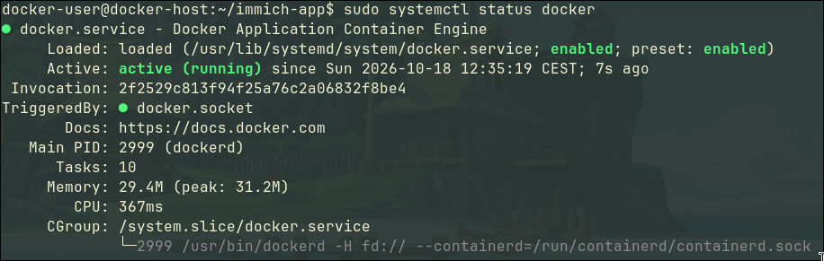

Also add your user to the `docker` group, so that you do not have to escalate privileges every time you want to run `docker compose`:
```bash
sudo usermod -aG docker <YOUR USER>
```

Exit out of SSH and back in, so that the change takes effect.

Now that we have docker running, we can finally move on the the last step:

### Installing Immich
For this part I will be following the [Quick start guide](https://docs.immich.app/overview/quick-start/) from the Immich docs.

The first step is to create a directory to hold my **docker-compose.yml** and **.env** files.
```bash
mkdir immich-app
cd immich-app/
```

Download the `docker-compose.yml` and `example.env` from the Immich github:
```
wget -O docker-compose.yml https://github.com/immich-app/immich/releases/latest/download/docker-compose.yml

wget -O .env https://github.com/immich-app/immich/releases/latest/download/example.env
```

Now we can configure the .env file to set the upload location for our images, set the timezone and the DB password. Remember to actually change the DB password! Leaving the default Postgres password is a big security flaw in your homelab.

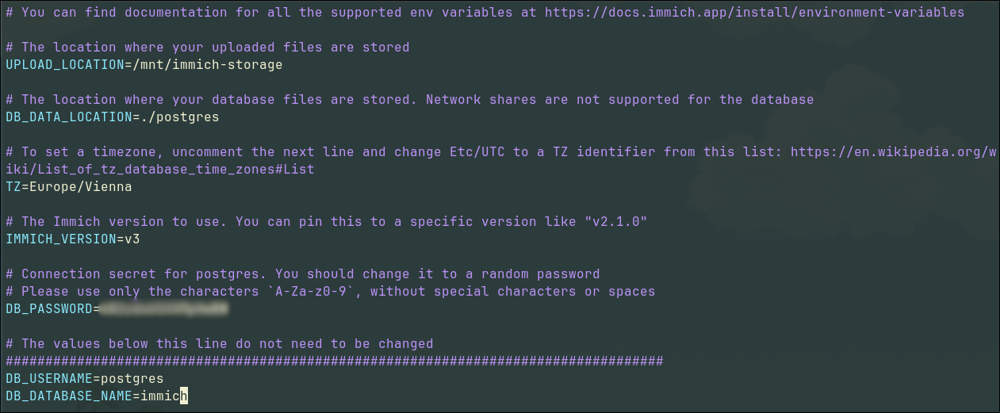

Finally we can start the Immich docker container:
```bash
docker compose up -d
```

It will pull all necessary containers from the internet and start them up. Now the app can be accessed at **http://YOUR_VM_IP:2283**

You will be greeted with the setup screen:


Add some **Users** for the people that want to use the app under **Administration > Users > Create User** and explore the rest of the settings.

You can now download Immich clients onto your devices and connect them to your server. Voila, a self-hosted photo backup and organisation solution.

## Conclusion
My Fiancee has been happily using Immich to archive and organise all of our vacation photos and she is very happy so far. I am happy to finally rid myself of another piece of the Google cloud. Everyone wins!

The next project I want to realize is to set up a **Raspberry Pi** as my **[OpenVPN](https://openvpn.net/)/[WireGuard](https://www.wireguard.com/)** access point, so that I can access all of my installed services from anywhere in the world. Stay tuned!
